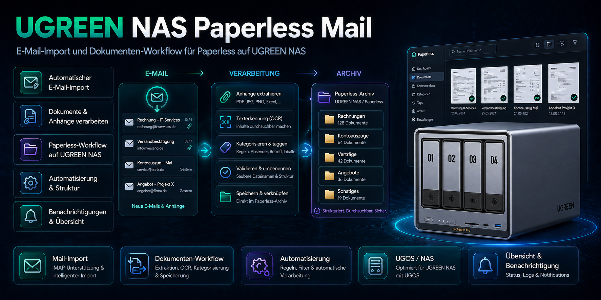

# Paperless Mail (UGREEN NAS)

[](https://github.com/Railsimulatornet/UGREEN-NAS-Paperless-Mail/actions/workflows/quality.yml)
[](LICENSE)



[Deutsch](#deutsch) · [English](#english)

## Deutsch

Community-Paket für **UGREEN NAS mit UGOS Pro**. Es kombiniert paperless-ngx, PostgreSQL und Redis mit einem Export-Skript für ZIP-Exporte, Aufbewahrung und optionale E-Mail-Berichte.

### Funktionen

- Docker-Compose-Projekt mit paperless-ngx, PostgreSQL 18 und Redis 8.
- Dokumentexport über `document_exporter` im laufenden Paperless-Container.
- Zeitgestempelte ZIP-Dateien mit konfigurierbarer Aufbewahrung.
- E-Mail bei Fehlern und optional bei Erfolg, als Text oder Text mit HTML.
- Optionale Listen der vorhandenen Backups und exportierten Dokumente in der Mail.
- Deutsche und englische Paketdateien mit jeweils eigenem PDF-Handbuch.

### Voraussetzungen

- UGREEN NAS mit UGOS Pro, Docker Compose und Zugriff per SSH.
- Bash und Zugriff auf den Docker-Dienst für das Export-Skript.
- Für E-Mail-Berichte: `curl` auf der NAS und ein erreichbarer SMTP-Server.
- Ausreichend Speicher für Dokumente, Datenbank und Exporte.

### Schnellstart

1. Kopiere den Ordner [de/paperless-ngx/](de/paperless-ngx/) oder [en/paperless-ngx/](en/paperless-ngx/) aus dem Repository nach `/volume2/docker/paperless-ngx/`. Fertige Sprachpakete findest du auch unter [Releases](https://github.com/Railsimulatornet/UGREEN-NAS-Paperless-Mail/releases/latest).
2. Passe `paperlessngx.env` an. Ersetze die Platzhalter für Admin-Passwort, `PAPERLESS_SECRET_KEY`, Datenbankpasswort und gegebenenfalls SMTP-Zugang.
3. Prüfe `docker-compose.yaml`: Der Webport und die Hostpfade stehen **direkt in dieser Datei**. Bei einem anderen Installationspfad musst du auch die Export- und Logpfade in `paperlessngx.env` anpassen.
4. Starte das Projekt:

```bash
cd /volume2/docker/paperless-ngx
docker compose config --quiet
docker compose up -d
```

Die Compose-Datei lädt `paperlessngx.env` bereits über `env_file`. Öffne anschließend `http://<NAS-IP>:8180` und melde dich mit dem konfigurierten Admin-Konto an. Alternativ kannst du den Projektordner in der UGREEN Docker-App importieren.

### Konfiguration

| Datei / Bereich | Wichtige Werte |
|---|---|
| `docker-compose.yaml` | Webport `8180:8000`; Hostordner `data`, `media`, `export`, `consume` unter `/volume2/docker/paperless-ngx/` |
| Benutzerrechte | `USERMAP_UID`, `USERMAP_GID` |
| Paperless | `PAPERLESS_ADMIN_USER`, `PAPERLESS_ADMIN_PASSWORD`, `PAPERLESS_SECRET_KEY`, `PAPERLESS_TIME_ZONE`, `PAPERLESS_OCR_LANGUAGE` |
| Datenbank | `POSTGRES_PASSWORD` und `PAPERLESS_DBPASS` müssen übereinstimmen |
| Export | `PAPERLESS_CONTAINER_NAME`, `PAPERLESS_HOST_BACKUP_DIR`, `PAPERLESS_CONTAINER_TMP_DIR`, `PAPERLESS_EXPORT_LOGFILE` |
| Aufbewahrung | `PAPERLESS_KEEP_FILES`, Standard: 10 ZIP-Dateien |
| Mail | `MAIL_ENABLED`, `MAIL_ON_SUCCESS`, `MAIL_ON_FAILURE`, `MAIL_SEND_HTML` |
| SMTP | `SMTP_HOST`, `SMTP_PORT`, `SMTP_USER`, `SMTP_PASS`, `MAIL_FROM`, `MAIL_TO`, `TLS_ENABLED` |

Mit `TLS_ENABLED=1` wird bei Port 465 SMTPS verwendet, sonst STARTTLS. Ein leerer `SMTP_PORT` verwendet bei aktiviertem TLS Port 587. Ohne Mailversand setze `MAIL_ENABLED=0`. Für eine Erfolgsmail setze `MAIL_ON_SUCCESS=1`; die Vorlage meldet standardmäßig nur Fehler.

Weitere Einstellungen für Dateinamen, OCR und Mail-Dateilisten sind in [paperlessngx.env](de/paperless-ngx/paperlessngx.env) beschrieben.

### Export und Zeitplan

Starte den ersten Export auf der NAS, wenn Paperless läuft:

```bash
cd /volume2/docker/paperless-ngx/scripts
bash ./paperless-export_with_mail.sh
```

Das Skript findet `../paperlessngx.env` automatisch. Die ZIP landet standardmäßig in `/volume2/docker/paperless-ngx/export/`, das Log in `scripts/exporter.log`.

Eine andere Konfigurationsdatei kannst du explizit angeben:

```bash
ENV_FILE=/volume2/docker/paperless-ngx/paperlessngx.env bash /volume2/docker/paperless-ngx/scripts/paperless-export_with_mail.sh
```

Nach erfolgreichem Test kannst du über `crontab -e` einen täglichen Lauf um 02:10 Uhr einrichten:

```cron
10 2 * * * /bin/bash /volume2/docker/paperless-ngx/scripts/paperless-export_with_mail.sh >> /volume2/docker/paperless-ngx/scripts/cron.log 2>&1
```

Die Aufbewahrung entfernt ältere `paperless_export_*.zip` nach einem erfolgreichen Export. Plane neben den Dokumentexporten auch die Sicherung deiner Konfiguration und der persistenten Datenbank- und Redis-Volumes ein.

### Aktualisierung

Behalte deine angepasste `paperlessngx.env`, Compose-Datei und Daten. Sichere sie vor einem Update und prüfe die Versionshinweise der verwendeten Container. Aktualisiere das vorhandene Projekt mit:

```bash
cd /volume2/docker/paperless-ngx
docker compose pull
docker compose up -d
```

Bei einem Skriptupdate ersetzt du `scripts/paperless-export_with_mail.sh` und prüfst anschließend einen manuellen Export.

### Projektstruktur und Dokumentation

| Inhalt | Pfad |
|---|---|
| Deutsche Paketquelle | [de/paperless-ngx/](de/paperless-ngx/) |
| Englische Paketquelle | [en/paperless-ngx/](en/paperless-ngx/) |
| Handbuch Deutsch | [UGREEN_Paperless-ngx_Anleitung_DE_v1.0.pdf](de/UGREEN_Paperless-ngx_Anleitung_DE_v1.0.pdf) |
| Handbuch Englisch | [UGREEN_Paperless-ngx_Guide_EN_v1.0.pdf](en/UGREEN_Paperless-ngx_Guide_EN_v1.0.pdf) |

### Fehlersuche

| Problem | Prüfen |
|---|---|
| Weboberfläche fehlt | `docker compose ps`, Containerlogs und Port 8180 bzw. den angepassten Port |
| Export findet den Container nicht | `PAPERLESS_CONTAINER_NAME`, Standard: `Paperless-ngx` |
| Export oder Log nicht beschreibbar | Hostpfade, Ordnerrechte und UID/GID |
| Keine Mail | `MAIL_ENABLED`, Erfolg-/Fehler-Schalter, SMTP-Zugang und `exporter.log` |

### Lizenz

[MIT-Lizenz](LICENSE). Roman Glos / Railsimulatornet.

## English

Community package for **UGREEN NAS running UGOS Pro**. It combines paperless-ngx, PostgreSQL and Redis with an export script for ZIP exports, retention and optional email reports.

### Features

- Docker Compose project with paperless-ngx, PostgreSQL 18 and Redis 8.
- Document export through `document_exporter` inside the running Paperless container.
- Timestamped ZIP files with configurable retention.
- Email on failure and optionally on success, as plain text or plain text with HTML.
- Optional lists of available backups and exported documents in the email.
- German and English package files, each with a separate PDF manual.

### Requirements

- UGREEN NAS with UGOS Pro, Docker Compose and SSH access.
- Bash and access to the Docker service for the export script.
- For email reports: `curl` on the NAS and a reachable SMTP server.
- Enough storage for documents, the database and exports.

### Quick start

1. Copy [en/paperless-ngx/](en/paperless-ngx/) or [de/paperless-ngx/](de/paperless-ngx/) from the repository to `/volume2/docker/paperless-ngx/`. Ready-made language packages are also available under [Releases](https://github.com/Railsimulatornet/UGREEN-NAS-Paperless-Mail/releases/latest).
2. Edit `paperlessngx.env`. Replace the placeholders for the admin password, `PAPERLESS_SECRET_KEY`, database password and, if used, SMTP credentials.
3. Check `docker-compose.yaml`: The web port and host paths are defined **directly in this file**. If you use another installation path, also update the export and log paths in `paperlessngx.env`.
4. Start the project:

```bash
cd /volume2/docker/paperless-ngx
docker compose config --quiet
docker compose up -d
```

The Compose file already loads `paperlessngx.env` through `env_file`. Then open `http://<NAS-IP>:8180` and sign in with the configured admin account. Alternatively, import the project folder in the UGREEN Docker app.

### Configuration

| File / area | Important values |
|---|---|
| `docker-compose.yaml` | Web port `8180:8000`; host folders `data`, `media`, `export`, `consume` under `/volume2/docker/paperless-ngx/` |
| User permissions | `USERMAP_UID`, `USERMAP_GID` |
| Paperless | `PAPERLESS_ADMIN_USER`, `PAPERLESS_ADMIN_PASSWORD`, `PAPERLESS_SECRET_KEY`, `PAPERLESS_TIME_ZONE`, `PAPERLESS_OCR_LANGUAGE` |
| Database | `POSTGRES_PASSWORD` and `PAPERLESS_DBPASS` must match |
| Export | `PAPERLESS_CONTAINER_NAME`, `PAPERLESS_HOST_BACKUP_DIR`, `PAPERLESS_CONTAINER_TMP_DIR`, `PAPERLESS_EXPORT_LOGFILE` |
| Retention | `PAPERLESS_KEEP_FILES`, default: 10 ZIP files |
| Email | `MAIL_ENABLED`, `MAIL_ON_SUCCESS`, `MAIL_ON_FAILURE`, `MAIL_SEND_HTML` |
| SMTP | `SMTP_HOST`, `SMTP_PORT`, `SMTP_USER`, `SMTP_PASS`, `MAIL_FROM`, `MAIL_TO`, `TLS_ENABLED` |

With `TLS_ENABLED=1`, port 465 uses SMTPS; other ports use STARTTLS. An empty `SMTP_PORT` uses port 587 when TLS is enabled. Set `MAIL_ENABLED=0` to disable email. Set `MAIL_ON_SUCCESS=1` for success emails; the template reports failures only by default.

Further options for file naming, OCR and email file lists are documented in [paperlessngx.env](en/paperless-ngx/paperlessngx.env).

### Exports and scheduling

Run the first export on the NAS once Paperless is running:

```bash
cd /volume2/docker/paperless-ngx/scripts
bash ./paperless-export_with_mail.sh
```

The script automatically finds `../paperlessngx.env`. By default, the ZIP is stored in `/volume2/docker/paperless-ngx/export/` and the log in `scripts/exporter.log`.

You can explicitly select another configuration file:

```bash
ENV_FILE=/volume2/docker/paperless-ngx/paperlessngx.env bash /volume2/docker/paperless-ngx/scripts/paperless-export_with_mail.sh
```

After a successful test, use `crontab -e` to schedule a daily run at 02:10:

```cron
10 2 * * * /bin/bash /volume2/docker/paperless-ngx/scripts/paperless-export_with_mail.sh >> /volume2/docker/paperless-ngx/scripts/cron.log 2>&1
```

Retention removes older `paperless_export_*.zip` files after a successful export. Alongside document exports, plan backups of your configuration and persistent database and Redis volumes.

### Updates

Keep your customised `paperlessngx.env`, Compose file and data. Back them up before an update and check the release notes of the containers in use. Update the existing project with:

```bash
cd /volume2/docker/paperless-ngx
docker compose pull
docker compose up -d
```

For a script update, replace `scripts/paperless-export_with_mail.sh`, then check a manual export.

### Project structure and documentation

| Content | Path |
|---|---|
| German package source | [de/paperless-ngx/](de/paperless-ngx/) |
| English package source | [en/paperless-ngx/](en/paperless-ngx/) |
| German manual | [UGREEN_Paperless-ngx_Anleitung_DE_v1.0.pdf](de/UGREEN_Paperless-ngx_Anleitung_DE_v1.0.pdf) |
| English manual | [UGREEN_Paperless-ngx_Guide_EN_v1.0.pdf](en/UGREEN_Paperless-ngx_Guide_EN_v1.0.pdf) |

### Troubleshooting

| Problem | Check |
|---|---|
| Web interface unavailable | `docker compose ps`, container logs and port 8180 or your configured port |
| Export cannot find the container | `PAPERLESS_CONTAINER_NAME`, default: `Paperless-ngx` |
| Export or log is not writable | Host paths, folder permissions and UID/GID |
| No email | `MAIL_ENABLED`, success/failure switches, SMTP credentials and `exporter.log` |

### License

[MIT License](LICENSE). Roman Glos / Railsimulatornet.
